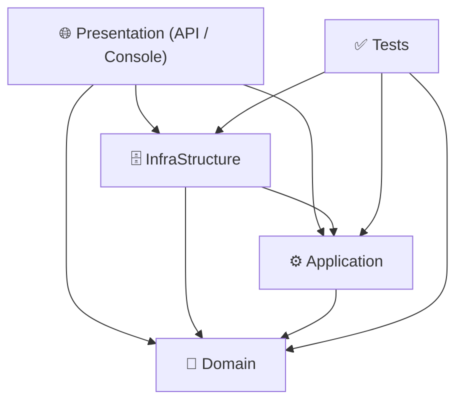

<div align="center">

# 🏗️ ArchGen

**Gerador profissional de soluções C# (.NET 8.0) em Clean Architecture, construído ele mesmo em Clean Architecture com EF Core, Injeção de Dependência, Sistema de Templates customizáveis e Testes Unitários com Mocks.**

[](https://dotnet.microsoft.com/)
[](https://learn.microsoft.com/dotnet/csharp/)
[](https://learn.microsoft.com/ef/core/)
[](https://xunit.net/)

</div>

---

## 📑 Índice

- [Visão Geral](#-visão-geral)
- [Arquitetura do ArchGen](#-arquitetura-do-archgen)
- [Funcionalidades Principais](#-funcionalidades-principais)
- [Tabela de Ajuda no Terminal (`--help`)](#-tabela-de-ajuda-no-terminal---help)
- [Como Usar](#-como-usar)
  - [Geração de Projetos (API e Console)](#geração-de-projetos)
  - [Gerenciamento e Customização de Templates](#gerenciamento-e-customização-de-templates)
  - [Histórico de Projetos Gerados](#histórico-de-projetos-gerados)
- [Estrutura das Soluções Geradas](#-estrutura-das-soluções-geradas)
- [Banco de Dados (EF Core + SQLite)](#-banco-de-dados-ef-core--sqlite)
- [Testes Unitários com Mocks](#-testes-unitários-com-mocks)
- [Licença](#-licença)

---

## 🔎 Visão Geral

O **ArchGen** é uma ferramenta CLI desenvolvida em C# com .NET 8.0 que automatiza a criação de projetos em Clean Architecture.

Além de gerar soluções prontas para produção (nos modos `API` e `CONSOLE`), o ArchGen possui:
1. **Sistema de Templates Padrão & Customizáveis**: Permite clonar o template padrão, manipular arquivos dentro dele (edição de código, inclusão de classes, alteração de configurações) e persistir o novo template no banco de dados.
2. **Histórico Automático**: Cada projeto gerado tem seus metadados (nome, caminho, tipo, template utilizado, data/hora e status) salvos no banco SQLite.
3. **Tabela de Ajuda no Console**: Ao executar `ArchGen --help`, exibe uma tabela rica e formatada com comandos, sintaxes, opções e exemplos práticos.
4. **Testes Unitários com Mocks**: Cobertura completa de testes para Domain, Application, Infrastructure e CLI usando xUnit, Moq e FluentAssertions.

---

## 🏛️ Arquitetura do ArchGen

O próprio ArchGen foi desenvolvido rigorosamente seguindo os princípios de **Clean Architecture**:

```
ArchGen/
├── ArchGen.Domain/              # Regras de Negócio e Entidades Centrais
│   ├── Entities/                # ProjectHistory, TemplateDefinition, TemplateFileDefinition
│   ├── Enums/                   # ProjectTypeEnum, ProjectStatusEnum, ProjectLayerEnum
│   ├── Exceptions/              # DomainException, ValidationException, TemplateNotFoundException
│   └── Interfaces/              # ITemplateRepository, IProjectHistoryRepository, IFileService, ITerminalService
│
├── ArchGen.Application/         # Casos de Uso e Orquestração
│   ├── DTOs/                    # GenerateProjectRequest, TemplateDtos, ProjectHistoryDto, HelpItemDto
│   ├── Interfaces/              # IGenerateProjectUseCase, ITemplateUseCase, IProjectHistoryUseCase, IHelpUseCase
│   ├── UseCases/                # GenerateProjectUseCase, TemplateUseCase, ProjectHistoryUseCase, HelpUseCase
│   └── DependencyInjection.cs   # Injeção de dependência da camada Application
│
├── ArchGen.InfraStructure/      # Persistência e Acesso a Recursos
│   ├── Data/                    # AppDbContext (EF Core com SQLite)
│   ├── Repositories/            # TemplateRepository, ProjectHistoryRepository
│   ├── Services/                # DefaultTemplateProvider, PhysicalFileService, TerminalService
│   └── DependencyInjection.cs   # Injeção de dependência da camada Infrastructure
│
├── ArchGen/                     # Camada de Apresentação (Console CLI)
│   ├── Cli/                     # CommandLineParser, CliRunner (Tabelas e Cores)
│   └── Program.cs               # Configuração do Host DI e Execução
│
└── ArchGen.Tests/               # Suíte de Testes Unitários
    ├── Domain/                  # Testes das entidades e validações de domínio
    ├── Application/             # Testes dos UseCases com Mocks (Moq)
    ├── InfraStructure/          # Testes dos repositórios com EF Core InMemory
    └── Cli/                     # Testes do parser e runner CLI
```

---

## ⚡ Funcionalidades Principais

| Funcionalidade | Descrição |
|---|---|
| 🚀 **Geração Limpa** | Cria projetos em Clean Architecture (`API` ou `CONSOLE`) com todas as referências conectadas e compiláveis. |
| 🧩 **Templates no Banco** | Clona o template padrão e permite manipular qualquer arquivo antes de salvar como um novo template no SQLite. |
| 🗃️ **EF Core & SQLite** | Persistência automática de templates e histórico sem necessidade de configuração prévia. |
| 📋 **Tabela de Ajuda** | Exibe ajuda rica em console via `ArchGen --help`. |
| 📜 **Auditoria e Histórico** | Consulta detalhada de projetos gerados pelo comando `ArchGen history`. |
| 🧪 **Testes Unitários** | 82+ testes cobrindo todas as funcionalidades com Moq e FluentAssertions. |

---

## 📖 Tabela de Ajuda no Terminal (`--help`)

Executando:
```bash
dotnet run --project ArchGen -- --help
# ou
ArchGen --help
```

A seguinte tabela é exibida no console:

```
╔═══════════════════════════════════════════════════════════════════════════════════════════════════════════════════════════════════════════════════════════════════╗
║                                                    ARCHGEN - GERADOR DE ARQUITETURA LIMPA EM C# (.NET 8.0)                                                    ║
║                                                  Guia Completo de Comandos, Templates e Gerenciamento                                                       ║
╠═══════════════════════════════════════════════════════════════════════════════════════════════════════════════════════════════════════════════════════════════════╣
║ Comando            ║ Sintaxe                                ║ Descrição                                      ║ Exemplo de Uso                                     ║
╠═══════════════════════════════════════════════════════════════════════════════════════════════════════════════════════════════════════════════════════════════════╣
║ Ajuda Geral        ║ ArchGen --help (ou -h)                 ║ Exibe esta tabela de ajuda completa com        ║ ArchGen --help                                     ║
║                    ║                                        ║ comandos e exemplos de uso.                    ║                                                    ║
╟───────────────────────────────────────────────────────────────────────────────────────────────────────────────────────────────────────────────────────────────╢
║ Gerar Projeto      ║ ArchGen new <Nome> [Tipo] [Path]       ║ Gera uma solução C# (.NET 8.0) em Clean        ║ ArchGen new MeuProjeto API                         ║
║                    ║ [Opções]                               ║ Architecture completa (Domain, App, Infra,     ║ ArchGen new MeuConsole CONSOLE C:\Projetos         ║
║                    ║                                        ║ API/Console, Tests, sln).                      ║ --template CustomTemplate                          ║
╟───────────────────────────────────────────────────────────────────────────────────────────────────────────────────────────────────────────────────────────────╢
║ Listar Templates   ║ ArchGen template list                  ║ Lista todos os templates disponíveis (padrão e ║ ArchGen template list                              ║
║                    ║                                        ║ os salvos no banco de dados).                  ║                                                    ║
╟───────────────────────────────────────────────────────────────────────────────────────────────────────────────────────────────────────────────────────────────╢
║ Visualizar         ║ ArchGen template view <Nome> [--file   ║ Exibe os arquivos de um template ou o conteúdo ║ ArchGen template view Default                      ║
║ Template           ║ <Caminho>]                             ║ de um arquivo específico.                      ║ ArchGen template view MeuTemplate --file           ║
║                    ║                                        ║                                                ║ Domain/Entities/User.cs                            ║
╟───────────────────────────────────────────────────────────────────────────────────────────────────────────────────────────────────────────────────────────────╢
║ Criar Template     ║ ArchGen template create <NovoNome>     ║ Cria um novo template no banco de dados        ║ ArchGen template create CustomApi --from Default   ║
║                    ║ [Opções]                               ║ clonando o template padrão ou outro existente. ║ --desc "Template com entidades customizadas"       ║
╟───────────────────────────────────────────────────────────────────────────────────────────────────────────────────────────────────────────────────────────────╢
║ Manipular Arquivo  ║ ArchGen template edit-file <Nome>      ║ Modifica ou adiciona um arquivo no template e  ║ ArchGen template edit-file CustomApi --file        ║
║ do Template        ║ --file <Caminho> [Opções]              ║ salva as alterações no banco de dados.         ║ Domain/Entities/User.cs --from-file C:\meu-user.cs ║
╟───────────────────────────────────────────────────────────────────────────────────────────────────────────────────────────────────────────────────────────────╢
║ Excluir Template   ║ ArchGen template delete <Nome>         ║ Remove um template customizado do banco de     ║ ArchGen template delete CustomApi                  ║
║                    ║                                        ║ dados (o padrão não pode ser excluído).        ║                                                    ║
╟───────────────────────────────────────────────────────────────────────────────────────────────────────────────────────────────────────────────────────────────╢
║ Histórico de       ║ ArchGen history                        ║ Exibe a tabela com o histórico de todos os     ║ ArchGen history                                    ║
║ Projetos           ║                                        ║ projetos gerados pelo ArchGen salvos no banco. ║                                                    ║
╚═══════════════════════════════════════════════════════════════════════════════════════════════════════════════════════════════════════════════════════════════════╝
```

---

## 🚀 Como Usar

### Geração de Projetos

#### Gerar uma Web API em Clean Architecture
```bash
dotnet run --project ArchGen -- new MinhaApi API
```

#### Gerar uma aplicação Console em Clean Architecture
```bash
dotnet run --project ArchGen -- new MeuConsole CONSOLE
```

#### Gerar em um diretório customizado utilizando um template customizado
```bash
dotnet run --project ArchGen -- new Microservico API C:\MeusProjetos --template MeuTemplate
```

---

### Gerenciamento e Customização de Templates

O ArchGen permite que você pegue o template padrão, modifique qualquer arquivo interno ou adicione arquivos, salvando como um novo template no banco SQLite:

#### 1. Listar templates existentes
```bash
dotnet run --project ArchGen -- template list
```

#### 2. Inspecionar arquivos do template
```bash
dotnet run --project ArchGen -- template view Default
```

#### 3. Criar novo template a partir do padrão
```bash
dotnet run --project ArchGen -- template create MeuTemplate --from Default --desc "Template customizado da empresa"
```

#### 4. Manipular um arquivo dentro do template e salvar no banco
```bash
dotnet run --project ArchGen -- template edit-file MeuTemplate --file "src/{{PROJECT_NAME}}.Domain/Entities/User.cs" --content "// Código customizado do User"
# ou ler o conteúdo diretamente de um arquivo no disco:
dotnet run --project ArchGen -- template edit-file MeuTemplate --file "src/{{PROJECT_NAME}}.Domain/Entities/User.cs" --from-file "C:\Users\UserCustomizado.cs"
```

#### 5. Excluir template customizado
```bash
dotnet run --project ArchGen -- template delete MeuTemplate
```

---

### Histórico de Projetos Gerados

Cada projeto gerado pelo ArchGen é registrado no banco de dados. Para consultar o histórico:

```bash
dotnet run --project ArchGen -- history
```

Saída:
```
📜 HISTÓRICO DE PROJETOS GERADOS NO ARCHGEN:
───────────────────────────────────────────────────────────────────────────────────────────────────────────────────
ID   | Projeto              | Tipo     | Template        | Data de Criação     | Status   | Caminho
───────────────────────────────────────────────────────────────────────────────────────────────────────────────────
1    | MinhaApi             | API      | Default         | 2026-10-24 05:16:05 | Success  | C:\Projetos\MinhaApi
───────────────────────────────────────────────────────────────────────────────────────────────────────────────────
```

---

## 📁 Estrutura das Soluções Geradas

Toda solução gerada pelo ArchGen possui dependências estritamente unidirecionais em Clean Architecture:



### O que cada camada gerada contém:
- **`NomeDoProjeto.Domain`**: `BaseEntity`, entidade `User`, enum `UserStatus`, interface `IUserRepository`, exceção `DomainException`.
- **`NomeDoProjeto.Application`**: DTOs (`UserDto`, `CreateUserRequest`, `UpdateUserRequest`), `IUserUseCase`, `UserUseCase`, extensão de DI `AddApplication()`.
- **`NomeDoProjeto.InfraStructure`**: `AppDbContext` (EF Core SQLite), repositório `UserRepository`, extensão de DI `AddInfraStructure()`.
- **`NomeDoProjeto.API`** *(se API)*: `UsersController` com endpoints RESTful completos (GET, POST, PUT, DELETE), Swagger configurado, `Program.cs`.
- **`NomeDoProjeto.Console`** *(se Console)*: Host DI configurado com `Microsoft.Extensions.Hosting`, execução do caso de uso e log no terminal.
- **`NomeDoProjeto.Tests`**: Testes unitários com xUnit, Moq e FluentAssertions prontos para execução via `dotnet test`.

---

## 🧪 Testes Unitários com Mocks

A aplicação conta com testes unitários em **todas** as funcionalidades:
- **Domain**: Validações de entidades, regras de clonagem e manipulação de arquivos de template.
- **Application**: Testes de use cases com mocks (`Moq`) para `ITemplateRepository`, `IProjectHistoryRepository`, `IDefaultTemplateProvider` e `IFileService`.
- **Infrastructure**: Testes de repositório e EF Core com banco em memória.
- **CLI**: Testes de parser de linha de comando e execução de comandos.

Para executar os testes:
```bash
dotnet test
```

---

## 📄 Licença

Código autorizado para uso livre. Feito com C# e .NET 8.0.
